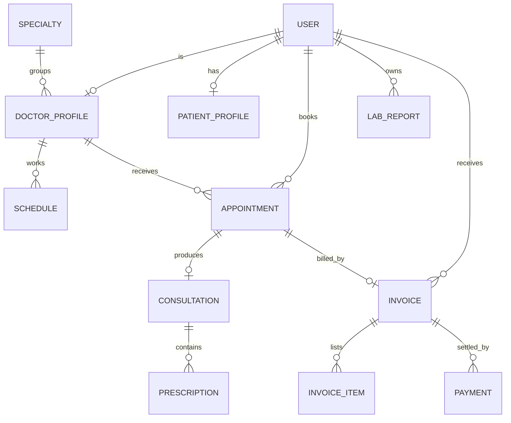

# CareDesk: architecture and modules

## Modules

| Module | Django app | What it does |
|---|---|---|
| 1. Users, roles and profiles | `accounts`, `clinic` | Patient self registration. Admin creates doctors, front desk staff and other admins. Role based access on every page. Patient health profile (blood group, allergies, emergency contact). Doctor profile with specialty, fee and room. |
| 2. Appointment scheduling | `appointments`, `clinic` | Doctors publish weekly working hours. Patients and front desk book from the free time slots only. The database itself blocks two live bookings for the same doctor, date and time. Cancel, no show and status tracking. |
| 3. Medical records | `records` | Doctors record vitals, diagnosis and notes, and write prescriptions. Printable visit summary. Patients and doctors upload lab reports (PDF, images) to **S3**. Downloads go through a permission check and a short lived signed link. |
| 4. Billing | `billing` | Invoices with line items. Consultation fee added automatically from a completed visit. Cash or card payments recorded by the front desk, simulated online payment by the patient, partial payments, void, printable invoice. |
| 5. Dashboards and administration | `dashboard` | A dashboard for each role, admin analytics (revenue by month, appointments by status, busiest doctors), user management, and an infrastructure page with live RDS and S3 tests. |

## What is stored where

| Data | Where |
|---|---|
| Users, doctors, patients, schedules, appointments, consultations, prescriptions, invoices, payments, and the path of every uploaded file | **Amazon RDS (PostgreSQL)** |
| Lab reports (`lab_reports/`), profile photos (`avatars/`) | **Amazon S3**, private bucket |
| Sessions | RDS (database sessions) |
| CSS | Served by the app (WhiteNoise) |

## Who can see what

| | Patient | Doctor | Front desk | Admin |
|---|---|---|---|---|
| Own appointments, records, reports, invoices | yes | n/a | n/a | n/a |
| Patient list and contact details | no | own patients | all | all |
| Medical notes, prescriptions, lab reports | own only | own patients | **never** | all |
| Book appointments | yes | no | for anyone | for anyone |
| Create invoices and record payments | no | no | yes | yes |
| Pay own invoice online (simulated) | yes | no | no | no |
| Edit working hours | no | own hours | no | any doctor |
| Create doctor, staff and admin accounts | no | no | no | yes |

"Own patients" means patients who have an appointment with that doctor.

## Entity relationship diagram



## Key rules implemented

* Slots are generated from the doctor's weekly schedule, minus live bookings and times already passed today.
* Bookings are allowed from now up to 60 days ahead.
* A partial unique constraint on (doctor, date, start time) for scheduled or completed appointments prevents double booking even if two people click at the same moment. Cancelling frees the slot.
* Saving a consultation completes the appointment. Only completed visits can be invoiced.
* Charges on an invoice are locked after the first payment. A payment cannot exceed the balance. An invoice with payments cannot be voided.
* Invoice status is calculated (draft, unpaid, partial, paid, void) from items and payments, never stored.
* Uploads are checked for type (pdf, png, jpg, txt, doc, docx, csv) and size (25 MB by default).
* Nobody can register as anything but a patient. Only an admin creates doctor, staff or admin accounts.

## Request path

```
Browser -> Nginx (EC2, or Beanstalk's Nginx) -> Gunicorn -> Django
                                                    |-> PostgreSQL on RDS  (psycopg2)
                                                    |-> S3 via boto3 and django-storages (IAM role, no keys)
```
